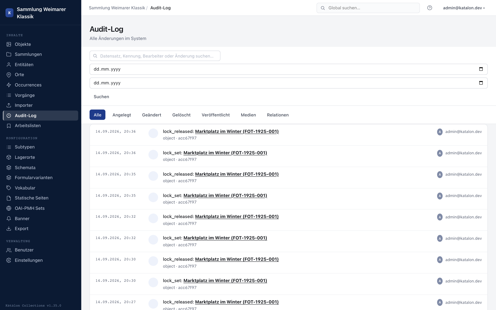

Das Audit-Log protokolliert jede Änderung an Bestandsdaten lückenlos: wer, wann, was geändert hat — inklusive Alt- und Neuwert je Feld. Es ist nicht abschaltbar und kann von Redakteur:innen nicht manipuliert werden.

Die typübergreifende Übersicht ist in der Admin-UI unter **Audit-Log** erreichbar; jeder einzelne Datensatz zeigt zusätzlich seine eigene Historie im Bearbeitungsformular.

---

## Protokollierte Aktionen

| Aktion | Beschreibung |
|---|---|
| **Erstellt** | Neuer Datensatz angelegt. |
| **Geändert** | Metadatenfeld(er) geändert — mit Alt-/Neuwert pro Feld. |
| **Gelöscht** | Datensatz gelöscht. |
| **Veröffentlicht** | Statuswechsel (z. B. Entwurf → Veröffentlicht). |
| **Medien hinzugefügt / geändert / gelöscht** | Änderungen an angehängten Mediendateien. |
| **Beziehung hinzugefügt / geändert / gelöscht** | Relationen zu anderen Datensätzen. |
| **KI-Schema-Assistent verwendet** | Anfrage an den [KI-Schema-Assistenten](/katalon-docs/administration/schema/#ki-schema-assistent) mit Datensatztyp, Subtyp, Modell und Token-Verbrauch. Protokolliert wird die Anfrage, nicht die anschließend angelegten Felder. |
| **KI-Übersetzung erstellt** | Erstellter [Übersetzungsvorschlag](/katalon-docs/administration/mehrsprachigkeit/#ki-gestützte-übersetzung) für ein mehrsprachiges Feld mit Modell, Quell- und Zielsprache. Protokolliert wird beim Erstellen, auch wenn der Vorschlag danach verworfen wird. |
| `ai_complete` | Erstellter [KI-Vorschlag für ein Feld](/katalon-docs/administration/schema/#ki-vorschläge-im-formular-verwenden) mit Feldname, Modell und Token-Verbrauch, ebenfalls beim Erstellen protokolliert. |
| `nl2sparql_generated` | Vom [KI-Abfrageassistenten](/katalon-docs/integration/sparql/#ki-abfrageassistent) erzeugte SPARQL-Abfrage mit Eingabetext, Modell und Token-Verbrauch. |

Für `ai_complete` und `nl2sparql_generated` zeigt die Oberfläche derzeit den technischen Bezeichner statt einer Beschriftung an.

Massenbearbeitungen erscheinen als einzelne Einträge pro betroffenem Datensatz, aber mit gemeinsamer Batch-Kennung — siehe [Massenbearbeitung](/katalon-docs/administration/batch-bearbeitung/).

---

## KI-generierte Feldwerte kennzeichnen

Unabhängig vom Audit-Log markiert Katalon einzelne Feldwerte, die durch den KI-Assistenten erzeugt wurden (Textvorschlag oder Übersetzung), direkt im Bearbeitungsformular mit einem kleinen **„KI"**-Symbol neben dem Feld. Der Mauszeiger zeigt beim Draufhalten Modellname und Erstellungszeitpunkt (`KI-generiert (<Modell>) am <Zeitpunkt>`).

Wird ein Vorschlag vor dem Übernehmen bearbeitet, bleibt die Markierung bei Text- und Richtext-Feldern erhalten, solange der übernommene Text dem Vorschlag noch weitgehend entspricht (Ähnlichkeit über 70 %). Bei anderen Feldtypen bleibt sie nur bei unverändertem Wert.

Diese Kennzeichnung (`ai_provenance`) steht für alle sieben Kerntypen zur Verfügung: Objekte, Entitäten, Orte, Occurrences, Vorgänge, Sammlungen und Lagerorte.

---

## Filtern und suchen

- **Volltextsuche** über Datensatzlabel und geänderte Werte.
- **Zeitraum** über Von-/Bis-Datum.
- **Aktionstyp**-Filterleiste (Alle, Erstellt, Geändert, Gelöscht, Veröffentlicht, Medien, Beziehung).
- Ergebnisse sind paginiert (50 Einträge pro Seite).

Ein Klick auf den Datensatznamen in einem Eintrag öffnet den betroffenen Datensatz direkt im Editor — auch über Datensatztypen hinweg (z. B. von einer Entität zu einem über Beziehung verlinkten Objekt).

---

## Aufbewahrung

Audit-Log-Einträge werden nicht automatisch gelöscht oder rotiert. Sie bleiben auch nach dem Löschen des zugehörigen Datensatzes erhalten und dokumentieren damit auch dessen Löschzeitpunkt und die löschende Person.
