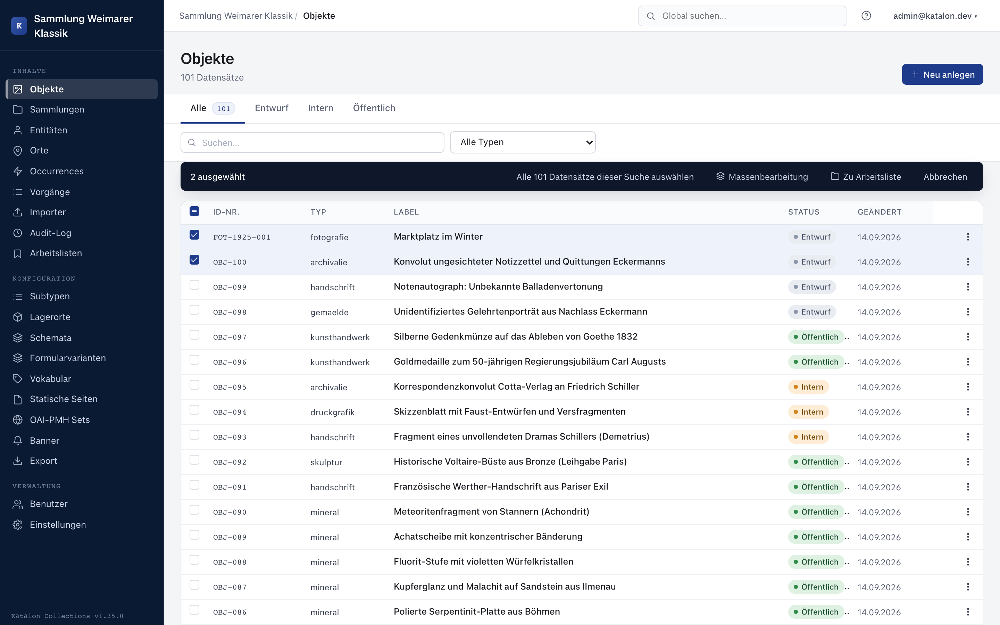
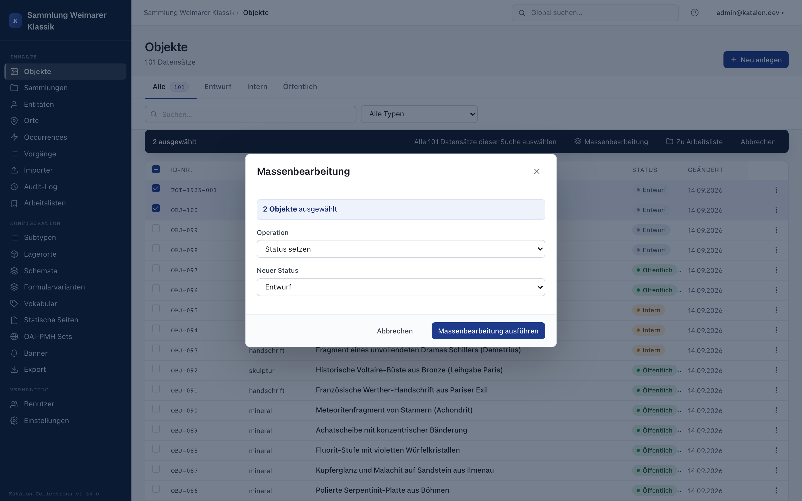

## Übersicht

Die Massenbearbeitung erlaubt es, dieselbe Operation auf viele Datensätze gleichzeitig anzuwenden, ohne jeden Datensatz einzeln zu öffnen. Sie ist in allen Listenansichten verfügbar: Objekte, Entitäten, Orte, Occurrences, Vorgänge, Sammlungen und Lagerorte.

:::note[Verfügbar ab Version 1.34.6]
Lagerorte in der Massenbearbeitung.
:::

## Einzelnen Datensatz öffnen und löschen

Klicken Sie auf den Labelwert eines Datensatzes, um ihn direkt zu öffnen. Für weitere Aktionen steht weiterhin das Menü mit den drei Punkten am rechten Rand der Tabellenzeile zur Verfügung.

:::note[Verfügbar ab Version 1.22.0]
:::

Datensätze lassen sich in den Papierkorb verschieben, über **Löschen** im Menü der Tabellenzeile oder über die Schaltfläche **Löschen** im Erfassungsformular. Die Schaltflächen erscheinen nur mit der Berechtigung zum Löschen dieses Typs.

:::note[Verfügbar ab Version 1.52.0]
Beide Wege zeigen dieselben Bestätigungen. Sind Datensätze verknüpft, weist Katalon darauf hin, dass alle Verknüpfungen beim Löschen entfernt werden. Haben Sammlungen oder Orte untergeordnete Datensätze, bietet Katalon an, diese eine Ebene hochzustufen (empfohlen) oder mit zu löschen.
:::

Administratoren finden gelöschte Datensätze im Tab **Papierkorb** der Liste und stellen sie dort mit **Wiederherstellen** wieder her. Der Tab steht bei Vorgängen nicht zur Verfügung. Gelöschte Datensätze bleiben im Papierkorb, bis sie wiederhergestellt oder von der automatischen Bereinigung endgültig entfernt werden.

## Auswahl treffen

1. In der linken Spalte der Tabelle einzelne Datensätze auswählen.
2. Über die Checkbox im Tabellenkopf alle Datensätze der aktuellen Seite auswählen.
3. Wenn mehr als eine Seite an Treffern vorhanden ist, erscheint in der Aktionsleiste der Link **„Alle N Datensätze dieser Suche auswählen"**. Damit wird die Auswahl auf alle Treffer der aktuellen Filter/Suche seitenübergreifend erweitert.
4. Auf **Massenbearbeitung** klicken.

## Unterstützte Operationen

| Operation | Beschreibung |
|---|---|
| **Status setzen** | Ändert den Veröffentlichungsstatus aller ausgewählten Datensätze. |
| **Feld setzen** | Überschreibt ein einzelnes Metadatenfeld. |
| **Feld anhängen** | Fügt bei wiederholbaren Feldern einen Wert hinzu, ohne bestehende Werte zu löschen. |
| **Feld leeren** | Setzt das Feld auf einen leeren Zustand zurück. |
| **Relation hinzufügen** | Verknüpft alle ausgewählten Datensätze mit einem Ziel-Datensatz. |
| **Relation entfernen** | Entfernt eine bestehende Verknüpfung zu einem Ziel-Datensatz. |

## Sicherheitshinweis

Ab **50 ausgewählten Datensätzen** erscheint eine Warnung. Die Aktion kann nicht automatisch rückgängig gemacht werden. Wenn Sie einen Wiederherstellungspunkt benötigen, legen Sie vorher manuell Snapshots der betroffenen Datensätze an.

Jede Massenbearbeitung wird im **Audit-Log** pro Datensatz mit einer gemeinsamen `batch_job_id` protokolliert.

## Asynchrone Verarbeitung

Ab **100 ausgewählten Datensätzen** läuft die Operation im Hintergrund über Celery. Das Frontend zeigt die Task-ID an. Aktualisieren Sie die Liste, um das Ergebnis zu sehen.

Nach Abschluss erhält die Person, die die Massenbearbeitung gestartet hat, zusätzlich eine E-Mail mit den Ergebniszahlen, sofern der Betreiber den E-Mail-Versand eingerichtet hat.
