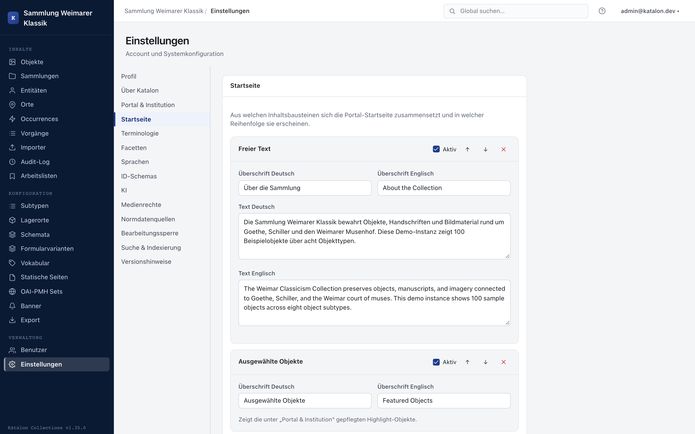

Settings bundle global, non-schema-related system configuration. In the admin UI, they are organized into sections under **Settings**; most sections are only visible to administrators.

Some sections are documented in detail on their own pages and are only linked here:

- **Facets** → [Setting up facets](../integration/portal-suche#facetten-einrichten)
- **Languages** → [Multilingual Support](/katalon-docs/en/administration/mehrsprachigkeit/)
- **Authority data sources** → [Authority Data & Linked Data](/katalon-docs/en/administration/normdaten/)
- **Edit lock** → [Locking a Record](/katalon-docs/en/administration/datensatz-sperren/)
- **Linked Data & SPARQL** → [SPARQL Endpoint (Oxigraph)](../integration/sparql)

The remaining sections are described below.

---

## Profile

Personal account settings: change email and password, generate/revoke your own **API keys** (for programmatic read access via the `X-API-Key` header), and restart the onboarding tour.

## Portal & Institution

Branding and basic configuration of the public portal:

- **Site title, subtitle, hero text** — configurable individually per language — and **logo** (upload directly in the form).
- **Placeholder image** for records without media.
- **Featured objects** on the homepage (list of record IDs).
- **Searchable record types** in the portal navigation (Objects, Entities, Places, Occurrences, Collections).
- **IIIF manifest link** on the object detail page, shown or hidden (default: shown when image media is present).
- **Allow media file downloads** (default: off). When on, the object detail page lists all public media files in original quality under **Downloads** below the viewer. When off, visitors who are not signed in cannot download files; signed-in staff still can.
- **Show views and downloads on detail pages** (default: off). Shows in the sidebar how often a record was viewed and, for objects with downloads allowed, how often its files were downloaded. Only takes effect while usage statistics are collected (see below).
- **Accent color** as well as individual color tokens (header background/text, page and panel background) for simple custom theming without CSS knowledge.
- **Position of the detail page sidebar** (left/right).
- **Metadata display** on detail pages: label above value (default) or "label: value" inline. In the inline layout, labels sit in a fixed column (long labels wrap) and the values start aligned next to it.
- **Field labels in uppercase** on detail pages (metadata and relations), default: off.
- **Logo in the header:** when a logo is set, it also appears in the header. Optionally hide the title text next to it, and hide title and subtitle on the homepage if the logo already contains them.

:::note[Available from version 1.42.0]
Logo in the header and related options.
:::

:::note[Available from version 1.40.0]
Toggle for the metadata display (label above value / "label: value") and for uppercase field labels.
:::

:::note[Available from version 1.36.0]
Site title, subtitle, and hero text are configurable per language; the portal shows the text for the active user language.
:::

:::note[Available from version 1.32.0]
Toggle for the IIIF manifest link on the object detail page.
:::

### Usage statistics

:::note[Available from version 1.50.0]
Usage statistics, portal display and media file downloads.
:::

The **Usage statistics** card under **Portal & Institution** switches counting on or off for the whole system (default: on). It counts how often public records are viewed in the portal and how often their files are downloaded from the download list. Katalon stores only daily counters per record, no IP addresses, cookies or session data. Signed-in staff and search engines are not counted. Showing an image in the viewer or playing a video is not a download.

The numbers appear in the record form toolbar (eye: views, arrow: downloads); a tooltip adds the figures for the last 30 days. With counting off, nothing is counted or shown; numbers collected so far are kept. Permanently deleting a record also deletes its counters.

The numbers are guidance, not audited statistics. If you run the portal with counting on, add a corresponding note to your privacy policy.

## Homepage

:::note[Available from version 1.28.0]
The portal homepage can be assembled from configurable content blocks, instead of being fixed to an object-centric entry point.
:::

Under **Settings → Homepage**, the public homepage can be assembled from an ordered list of blocks. Blocks can be added, reordered via arrow buttons, toggled on/off, and removed. Available block types:

- **Free text** — multilingual intro text (German/English), e.g. a welcome message or institutional context.
- **Featured objects** — shows the Featured Objects maintained under **Portal & Institution**; here only the maximum number is configurable.
- **Latest objects** — the most recently created objects, with a configurable count.
- **Collections** — top-level collections, all collections, the largest collections (most public objects) or a custom selection. For a custom selection, collections are added by searching their title and ordered with the arrow buttons.

:::note[Available from version 1.42.0]
"Largest collections" mode and collection selection by search instead of collection ID. Text blocks are rendered as Markdown (headings, lists, links); single line breaks are kept. Object cards show the same subtitle line as the search result list.
:::

Each block can have its own multilingual heading. If a referenced collection is missing or the list of Featured Objects is empty, the block is simply skipped — the homepage remains usable.

## Footer & Notice

:::note[Available from version 1.42.0]
:::

Under **Settings → Footer & notice** you configure the portal footer and a usage notice.

**Footer:** up to six columns of type **Text** (Markdown), **Links** or **Logos**, each with its own heading and reorderable. Links can point to external pages (`https://…`) or portal pages (`/page/impressum`); static pages placed in the "footer" can be appended automatically. Logos are uploaded directly (JPEG, PNG, WebP or GIF up to 5 MB) and need alt text. Below the columns is an optional **footer line** (Markdown), e.g. for copyright or funding notes. Without columns and footer text, the previous single-line footer remains.

**Usage notice:** a dialog every visitor confirms once per browser before using the portal — for example a note on historical content. Heading, text (Markdown) and button label are configurable. **Show to everyone again** increments the version, so after saving the notice reappears even for visitors who already confirmed it.

## Terminology

:::note[Available from version 1.29.0]
The labels shown in the portal for the core types can be customized per installation, without changing the data model or the API.
:::

Under **Settings → Terminology**, a custom label can be set for each core type visible in the portal — Objects, Entities, Places, Occurrences, Collections — separately for singular and plural, and per language (German/English). A library installation could, for instance, consistently display "Work"/"Works" instead of "Object"/"Objects", while a museum might use "Exhibit"/"Exhibits" — internally it remains the same record type `object`.

The configured terms are automatically used everywhere in the portal where the respective record type is named: main navigation, homepage, search results, facets, and detail pages. An empty field falls back to the built-in default label; **Reset to default** completely removes a saved customization for a type.

## ID Schemas

For each primary type, an **ID schema** with placeholders can be defined, from which the next ID is automatically suggested when creating a new record, e.g. `ulb_x_{counter:05d}`.

| Placeholder | Meaning |
|---|---|
| `{counter}` | Sequential number |
| `{counter:05d}` | Sequential number, zero-padded |
| `{year}` | Current year |
| `{type}` | Type abbreviation (`obj`/`ent`/`pla`/`occ`/`pro`) |

In addition, a **validation pattern** (regex) can be set per type, against which manually entered IDs are checked.

## AI

Global connection to an LLM (OpenAI-compatible API, e.g. OpenAI or OpenRouter). It is required for all AI features: [AI suggestions for fields](/katalon-docs/en/administration/schema/#setting-up-ai-suggestions-for-a-field), [AI-assisted translation](/katalon-docs/en/administration/mehrsprachigkeit/#ai-assisted-translation), the [AI schema assistant](/katalon-docs/en/administration/schema/#ai-schema-assistant), and the [AI query assistant for SPARQL](/katalon-docs/en/integration/sparql/#ai-query-assistant).

- **Base URL** and **model** (e.g. `https://api.openai.com/v1`, `gpt-4.1-mini`).
- The **API key** is stored encrypted in the database and is never returned in plain text after being set; **Test connection** checks the configuration without reference to a record.
- **Token limits**: maximum input/output tokens per request, as well as a **daily limit per user** and a **global monthly limit**, with a display of current consumption.

The token limits apply to all AI features together. Once a limit is reached, Katalon rejects further requests until the next day or month. Every AI request is logged in the [Audit Log](/katalon-docs/en/administration/audit-log/) with the model and token consumption.

## Media Rights

Default values that are automatically copied to every new media file upon upload: **default license** (URI) and **default rights holder** (name + optional URI). Changes only affect future uploads, not existing media retroactively.

## Search & Indexing

Manually trigger Elasticsearch reindexing — necessary after major schema changes or data imports outside the regular save path. Reindexing can be triggered per record type or for the entire holdings, and runs asynchronously in the background; a status widget shows the index state.

## About Katalon

Version, license, and link information (source code, license text, documentation), as well as access to the **release notes** (changelog).

## Danger Zone

::::caution
Irreversible action — be sure to read the confirmation text before use.
::::

Hides all non-system field definitions from the schema for a chosen primary type (optionally restricted to a subtype). **Records and their stored metadata values are not deleted in the process** — they remain in the database and become visible again as soon as a field with the same technical name is created again in the schema editor. The system fields `label` and `idno` are always preserved. To confirm, the label of the affected schema must be typed exactly (case-sensitive).

### Reset / delete vocabulary

:::note[Available since version 1.47.0]
A second card in the Danger Zone deletes either all terms of a vocabulary or the whole vocabulary. To confirm, type the vocabulary name in capital letters. Details are under [Vocabularies → Emptying or deleting a vocabulary](/katalon-docs/en/administration/vokabulare/#emptying-or-deleting-a-vocabulary).
:::
