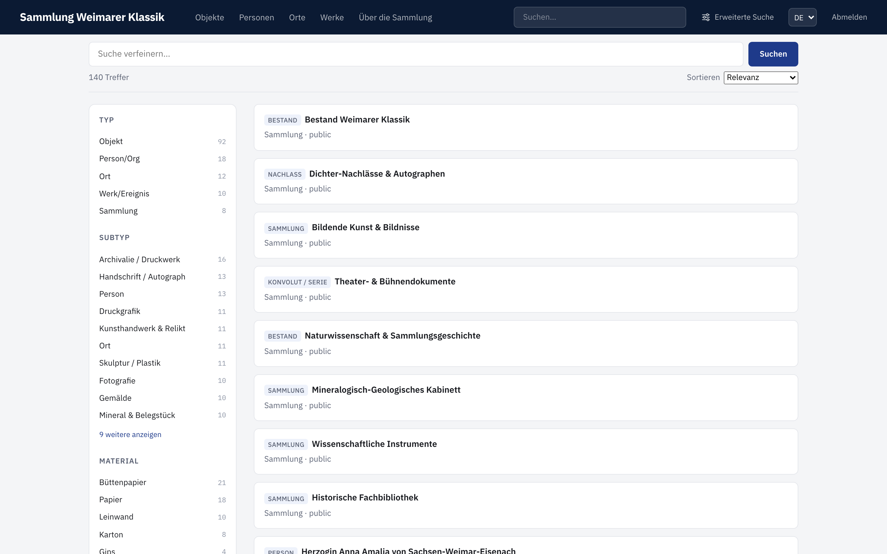
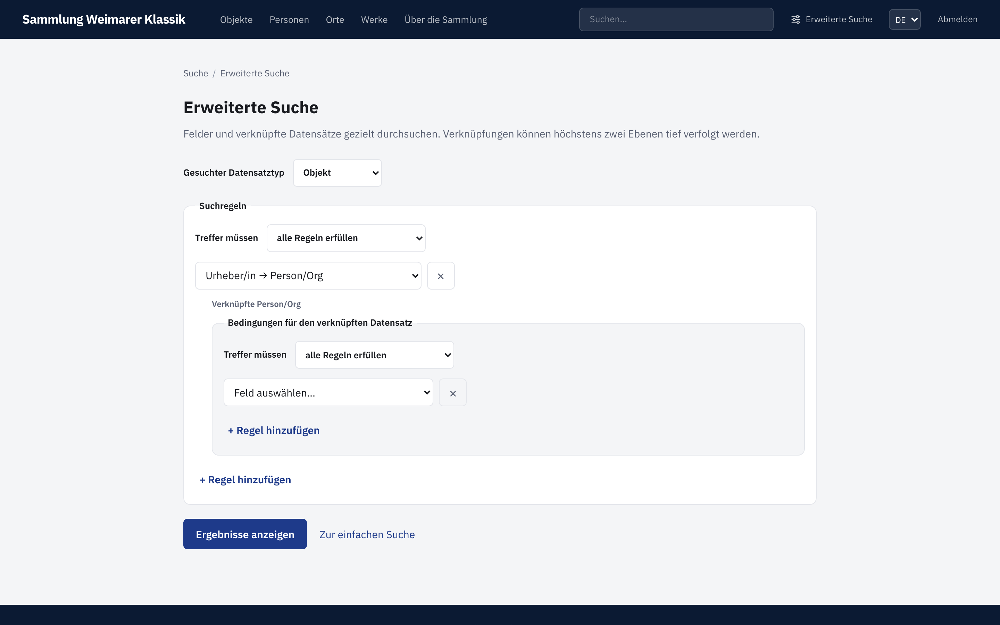
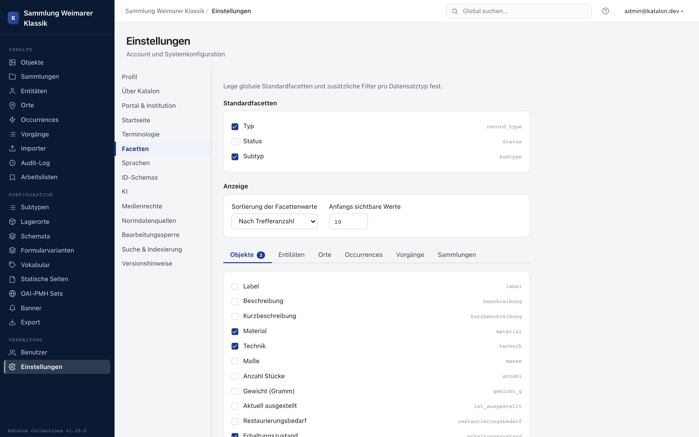

Die Schnellsuche im Kopf des Portals durchsucht Objekte, Entitäten, Orte und Occurrences gemeinsam. Auf der Ergebnisseite lassen sich Treffer weiter über die angebotenen Facetten eingrenzen. Jede Trefferkarte zeigt neben dem Titel eine kleine Kennzeichnung mit dem Subtyp des Datensatzes (z. B. „Gemälde", „Person"); hat der Datensatz keinen Subtyp, erscheint stattdessen der allgemeine Datensatztyp.

:::note[Verfügbar ab Version 1.36.0]
Einheitliche Subtyp-Kennzeichnung auf Trefferkarten.
:::

Zahlenfelder, die als Facette eingerichtet sind, werden als Bereich gefiltert. Geben Sie bei **Von** und **Bis** einen genauen Wert ein oder verschieben Sie die beiden Regler. Eine der beiden Grenzen kann leer bleiben; **Alle** entfernt den Zahlenbereich wieder.

Unter **Erweiterte Suche** wird zuerst der gewünschte Ergebnistyp gewählt. Danach lassen sich öffentliche Suchfelder mit **alle** oder **mindestens eine** kombinieren. Bei Relationsfeldern können Bedingungen für verknüpfte Datensätze ergänzt werden. Bis zu zwei Verknüpfungsschritte sind möglich, zum Beispiel:

> Objekte, deren Fotograf vor 1950 geboren wurde und dessen Geburtsort Bremen ist.

Bei festen Vokabularfeldern werden die zulässigen Begriffe zur Auswahl angeboten. Freie Vokabularfelder schlagen konfigurierte Begriffe vor, erlauben aber weiterhin einen eigenen Wert.

Die Ergebnisliste verwendet dieselbe Seite wie die Schnellsuche. Die Suchdefinition bleibt in der URL erhalten und kann daher als Lesezeichen gespeichert oder weitergegeben werden. Bei sehr breiten Relationsbedingungen fordert das Portal dazu auf, die Suche weiter einzugrenzen.

## Facetten einrichten

Welche Facetten im Portal angeboten werden, legen Sie in den Admin-Einstellungen unter **Facetten** pro Datensatztyp fest. Voraussetzung ist, dass das Feld öffentlich ausgegeben wird. Ob es auch in der Detailansicht erscheint, spielt keine Rolle mehr.

:::note[Verfügbar ab Version 1.26.0]
Das Ein- oder Ausschalten einer Facette wirkt **sofort** — ein Neuaufbau des Suchindex ist dafür nicht nötig. Nur wenn Sie die Sichtbarkeit eines Feldes selbst ändern (**„Öffentlich über APIs ausgeben“**), baut Katalon den Suchindex im Hintergrund neu auf; bei sehr großen Beständen kann das einige Minuten dauern (siehe [Schema verwalten](../../administration/schema)).
:::

:::note[Verfügbar ab Version 1.42.0]
Die Facette ist unabhängig von der Detailanzeige. Ein öffentliches Feld darf als Filter dienen, auch wenn es auf der Detailseite ausgeblendet ist. Eine Änderung der Detailanzeige allein löst keinen Neuaufbau des Suchindex aus.
:::

### Reihenfolge der Facetten

:::note[Verfügbar ab Version 1.42.0]
:::

Unter **Reihenfolge im Portal** stehen alle aktiven Facetten eines Typs in einer gemeinsamen Liste, gleich ob Feld-, Datums-, Hierarchie- oder Beziehungsfacette. Die Reihenfolge lässt sich per Ziehen oder mit den Pfeil-Buttons ändern (auch per Tastatur bedienbar) und gilt direkt für die Portalsuche. Facetten von Unterfeldern einer Gruppe erscheinen als „Gruppe › Feld“.

### Datumsfacetten nach Dekade, Jahrhundert oder Jahr

:::note[Verfügbar ab Version 1.42.0]
:::

Für Datumsfelder (auch innerhalb von Gruppen) legt die Option **Gruppierung als Portal-Facette** im Feldformular fest, ob die Facette nach **Dekade**, **Jahrhundert** oder **Jahr** zusammenfasst. Die Werte erscheinen chronologisch sortiert. Ein Zeitraum wie „1905/1912“ zählt in jeder Dekade, die er überdeckt; sehr lange Zeiträume (über 50 Jahre) zählen nur am Anfang und am Ende, damit sie die Facette nicht überschwemmen. Unplausible Jahreszahlen werden ignoriert. Eine Änderung der Gruppierung baut den Suchindex im Hintergrund neu auf.

### Hierarchische Schlagwortfacetten

:::note[Verfügbar ab Version 1.42.0]
:::

Felder, die auf ein hierarchisches Vokabular verweisen, erscheinen im Portal als aufklappbarer Baum mit Zählern. Die Auswahl eines Oberbegriffs filtert auf alle Datensätze mit diesem Begriff oder einem seiner Unterbegriffe.

### Beziehungsfacetten

:::note[Verfügbar ab Version 1.42.0]
:::

Beziehungsfacetten filtern nach verknüpften Datensätzen, eingeschränkt auf bestimmte Beziehungsarten — etwa Postkarten nach „Komponist_in“ oder nach einem Ort, der als Absende- oder Empfangsort verknüpft ist. Einrichtung unter **Einstellungen → Facetten → Beziehungsfacetten → Beziehungsfacette hinzufügen**:

- **Bezeichnung** auf Deutsch und Englisch; daraus wird ein **Schlüssel** vorgeschlagen, der in Such-Links verwendet wird.
- **Verknüpfter Typ** (Entität, Ort, Occurrence, Sammlung oder Objekt) und **Richtung** (dieser Datensatz → verknüpfter, umgekehrt oder beide).
- **Beziehungsarten** aus dem Vokabular „relation_types“; angeboten werden die Arten, die für diese Kombination von Typen erlaubt sind. Mehrere Arten lassen sich zu einer Facette zusammenfassen.
- Optional **Nur Subtypen**, um z. B. nur Personen eines bestimmten Subtyps zu berücksichtigen.

Die Facette zeigt nur öffentliche verknüpfte Datensätze. Auf Detailseiten im Portal verlinken passende Beziehungen direkt auf die gefilterte Suche. Hinzufügen oder Ändern einer Beziehungsfacette baut den Suchindex des Typs im Hintergrund neu auf.
